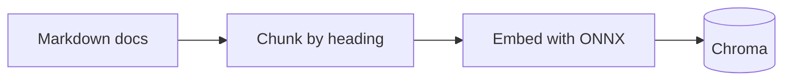
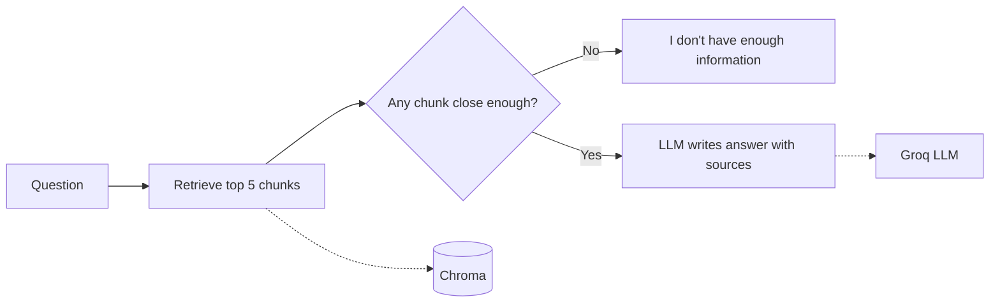
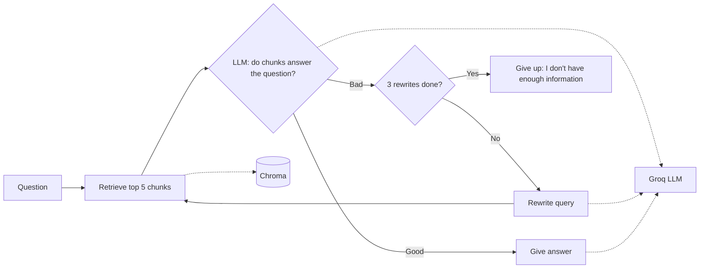
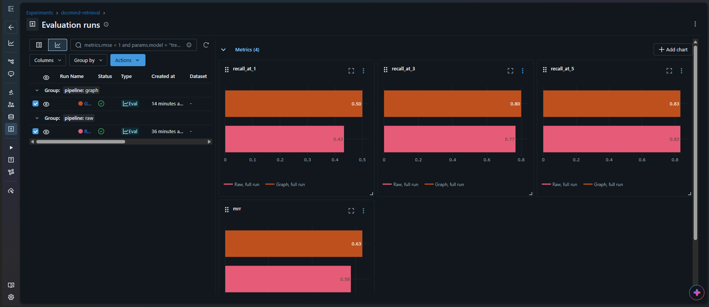

# DocMind

[](https://github.com/Mei9738/docmind/actions/workflows/ci.yml)

A RAG service that answers questions about the FastAPI documentation, with cited sources.

**Live demo:** [docmind-70yb.onrender.com/docs](https://docmind-70yb.onrender.com/docs). Try `POST /ask` in the browser. It runs on a free plan that sleeps when idle, so the first request can take about a minute.

The core pipeline is built from scratch, without a RAG framework: every step (loading, chunking, embedding, retrieval, prompting) is hand-written and tested. It was then rebuilt with LangGraph, as an agent that checks its own retrieval, and the two versions are compared with an evaluation suite.

## Results

Measured on 30 hand-written questions (see [Evaluation](#evaluation)).

- **Smarter chunks:** found the right section in the top 3 for **77%** of questions (up from 63%) by embedding each chunk together with its section heading, so chunks from the middle of a section still carry their topic.
- **LangGraph rebuild:** an LLM checks the retrieved chunks and rewrites the question if they're off-topic. This raised top-1 accuracy from **43% to 50%** in both graph runs. Top-5 varied between 80% and 83% across runs (raw: 83%), because the LLM checker doesn't answer the same way every time: a real gain at the top, at the cost of extra LLM calls and some run-to-run variation.
- **Fits on free hosting:** cut memory from **545 MB to 225 MB** by running the same embedding model with ONNX instead of PyTorch, with retrieval quality unchanged and tests 10× faster.

## Architecture

**Building the index** (once, `python -m docmind.ingest`):



**Answering a question, raw pipeline** (`POST /ask`):



**Answering a question, LangGraph pipeline** (`POST /ask-graph`):



Solid arrows are the flow; dotted arrows show what each step uses.

## How it works

**Ingestion** (`python -m docmind.ingest`)

1. **Load**: read every Markdown file in `data/`
2. **Chunk**: split each file on its headings; long sections are cut into fixed-size pieces with overlap
3. **Embed**: turn each chunk, together with its heading, into a vector with `all-MiniLM-L6-v2`, run with ONNX (no PyTorch needed)
4. **Store**: save chunks, vectors and metadata (source file, heading, position) in ChromaDB

**Answering** (`POST /ask`)

1. **Retrieve**: embed the question and fetch the closest chunks (cosine distance), discarding any above a relevance threshold
2. **Prompt**: build a grounded prompt with numbered chunks and the question
3. **Generate**: ask an LLM (via Groq) to answer from that context only
4. **Respond**: return the answer, its sources and the retrieval scores

If no chunk is relevant enough, the service says so instead of calling the LLM.

**Answering with LangGraph** (`POST /ask-graph`)

1. **Retrieve**: same as above
2. **Check**: an LLM judges whether the chunks actually answer the question
3. **Rewrite** (if not): the LLM rephrases the original question in the docs' vocabulary, avoiding earlier failed attempts, then retrieves again
4. **Answer or give up**: answer from good chunks, or say it doesn't know after 3 rewrites

## Evaluation

Retrieval is measured against a golden dataset ([`eval/golden.json`](eval/golden.json)): 30 questions written by hand in everyday words rather than copied from the docs, each labelled with the doc section(s) that answer it.

- **recall@k**: the share of questions where a correct section appears somewhere in the top k results.
- **MRR** (mean reciprocal rank): how early the first correct result appears, on average. 1.0 means always first, 0.5 means usually second.

```bash
python eval/run_eval.py raw "my note"     # or: graph
mlflow ui                                 # compare runs in the browser
```

Each run saves its settings, scores and per-question results, and logs them to MLflow. Changing one thing at a time:

| Change | recall@1 | recall@3 | recall@5 | MRR | Kept? |
|---|---|---|---|---|---|
| Baseline | 0.367 | 0.633 | 0.800 | 0.511 | |
| Ignore `#` comments inside code blocks | 0.367 | 0.633 | 0.800 | 0.511 | yes, correctness fix |
| Smaller chunks (500 / 100) | 0.367 | 0.667 | 0.733 | 0.500 | no |
| Heading embedded with each chunk | 0.433 | 0.767 | 0.833 | 0.578 | yes |
| LangGraph pipeline (2 runs) | **0.500** | 0.767–0.800 | 0.800–0.833 | **0.608–0.633** | mixed |

The LangGraph row is a range over two runs of the same code: its LLM steps aren't deterministic, so its scores vary slightly between runs. The raw pipeline gives identical results every time.

Full notes, including which questions moved and why: [`eval/experiments.md`](eval/experiments.md).



## Key decisions

- **Golden labels use source + heading, not chunk IDs.** Chunk IDs are positions that change with chunk size, so the answer key would silently break during experiments. Source + heading stays valid.
- **The eval turns off the relevance filter** (`max_distance = 2.0`). Otherwise correct chunks just above the threshold count as misses, and the eval would measure the filter instead of the ranking.
- **Rewrites always start from the original question**, plus the list of failed attempts. Rewriting a rewrite drifts away from what the user asked.
- **ONNX instead of PyTorch** for the same embedding model: memory from 545 MB to 225 MB, which fits free hosting, with identical eval scores.
- **The index is built during the Docker build**, from the current docs and code, so it can never be out of date, and the cloud can build it straight from GitHub.

## Limitations and next steps

- **The LangGraph checker sometimes rejects good results** (2 of 30 questions in one run), and the graph then keeps worse chunks from a later try. Next: keep the best chunks across all tries, and re-run the eval to confirm.
- **Answers can include details from the LLM's own memory**, such as a link that isn't in the docs. Next: remove any link that doesn't appear in the retrieved chunks.
- **The eval checks sections, not exact passages:** a chunk from the right section counts as a hit even if the answer is in a different chunk. Next: add an answer phrase to each golden question and check that it appears in the retrieved text.
- **The free host sleeps when idle**, so the first request takes about a minute. That's an accepted trade-off for a free demo.

## Project structure

```
src/docmind/
  loader.py      # Markdown files -> Document objects
  chunking.py    # Documents -> Chunks (headings + overlap split)
  ingest.py      # load -> chunk -> embed -> store in ChromaDB
  retrieval.py   # question -> top-k relevant chunks with distances
  prompts.py     # prompt templates: answer, grade, rewrite
  generate.py    # prompt -> LLM answer + sources
  graph.py       # LangGraph pipeline: retrieve -> check -> rewrite / answer
  metrics.py     # recall@k and reciprocal rank
  api.py         # FastAPI service: /ask (raw) and /ask-graph
  config.py      # shared settings (models, chunking, paths)
eval/
  golden.json    # 30 hand-written questions with their expected sections
  run_eval.py    # runs the questions, computes metrics, logs to MLflow
  experiments.md # log of every experiment and what it changed
tests/           # pytest unit tests (loader, chunking, prompts, metrics, golden labels)
scripts/         # small manual scripts (e.g. try the graph on one question)
data/            # corpus: FastAPI tutorial docs
Dockerfile, docker-compose.yml   # container setup
.github/workflows/ci.yml         # CI: lint, tests, retrieval eval on every push
```

## Getting started

Requires Python 3.11+ and a free [Groq](https://console.groq.com) API key.

```bash
python -m venv .venv
.venv\Scripts\Activate.ps1          # Windows (macOS/Linux: source .venv/bin/activate)
pip install -r requirements.txt
pip install -e .
```

Create a `.env` file in the project root (it is git-ignored):

```
GROQ_API_KEY=your_key_here
```

Build the index, then start the API:

```bash
python -m docmind.ingest
fastapi dev src/docmind/api.py
```

Open http://127.0.0.1:8000/docs to try `POST /ask` in the browser, or:

```bash
curl -X POST http://127.0.0.1:8000/ask \
  -H "Content-Type: application/json" \
  -d '{"question": "How do I make a query parameter optional?"}'
```

## Run with Docker

No Python setup needed: Docker installs everything, builds the search index and starts the API.

Copy the example environment file, then put your Groq key in `.env`:

```bash
copy .env.example .env              # Windows (macOS/Linux: cp .env.example .env)
```

Build and start the service:

```bash
docker compose up
```

The first build takes a few minutes, because it builds the search index. Then open http://localhost:8000/docs.

## Tests

```bash
pytest
```

## Data

The corpus in `data/` is a subset of the [FastAPI documentation](https://github.com/fastapi/fastapi), © Sebastián Ramírez, used under the MIT License (see `data/FASTAPI_LICENSE.txt`). Code examples in those docs are referenced by placeholders and are not included.
